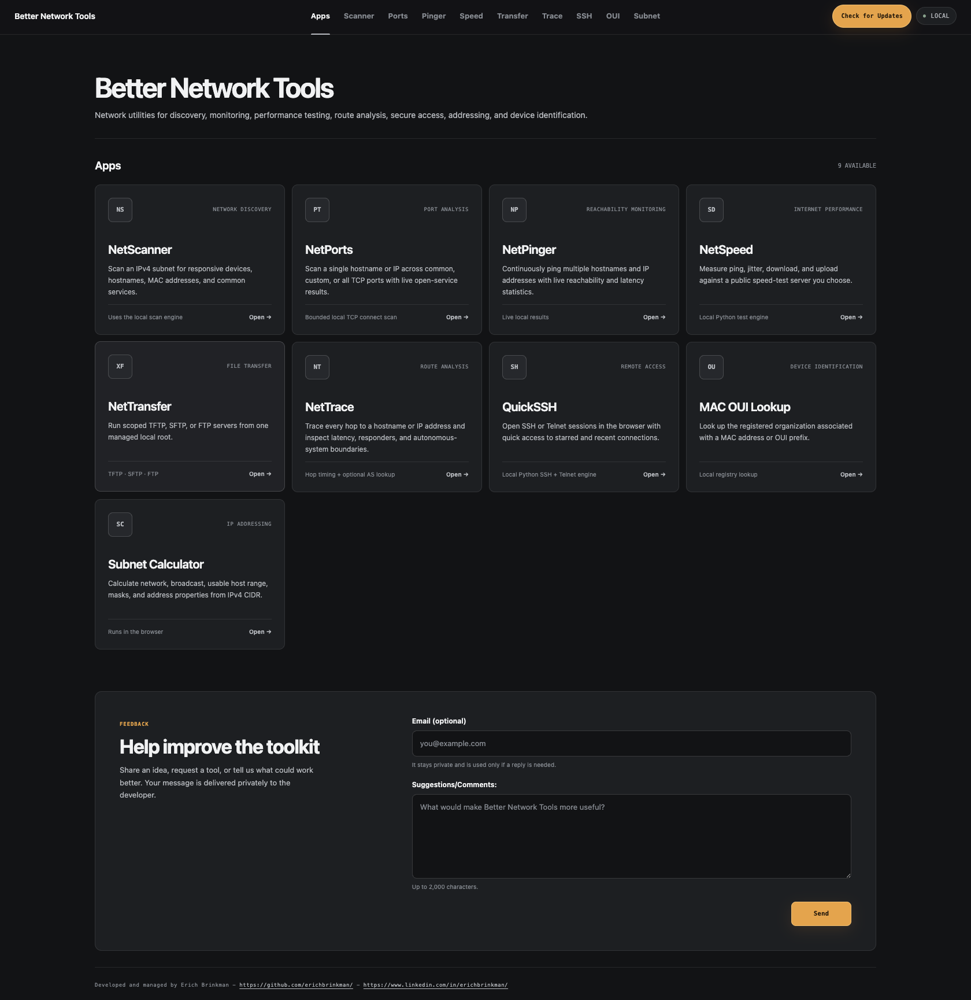

# Better Network Tools

Better Network Tools is a local-first collection of utilities for network
discovery, diagnostics, monitoring, file transfer, and remote access. The web
interface connects to a Python service on the same computer, so private-network
operations stay local by default.

> **Release status:** v0.1.0 is a source preview for evaluation and development.
> There is no signed installer or packaged desktop application yet. Review the
> source and run it with the development toolchain below.



> Use these tools only on networks and devices you own or are authorized to
> administer. See the [security guide](docs/security.md) before scanning,
> transferring files, or opening remote sessions.

## Tools

| Tool | Purpose |
| --- | --- |
| **NetScanner** | Discover devices on an authorized IPv4 subnet |
| **NetPorts** | Scan one host for open TCP ports |
| **NetPinger** | Monitor reachability and response time |
| **NetSpeed** | Measure internet latency and throughput |
| **NetTransfer** | Run a local TFTP, SFTP, or FTP server |
| **NetTrace** | Trace network routes and inspect hop latency |
| **QuickSSH** | Open SSH or Telnet sessions |
| **MAC OUI Lookup** | Identify a device manufacturer from its MAC address |
| **Subnet Calculator** | Calculate IPv4 networks, ranges, and masks |

## Requirements

- macOS or Windows
- Python 3.11 or newer
- Node.js 22.23.1 or newer
- Git
- pnpm 11.9.0, directly or through Corepack

## Run from source

```bash
git clone https://github.com/erichbrinkman/betternetworktools.git
cd betternetworktools
```

macOS:

```bash
python3 scripts/bootstrap.py
.venv/bin/python scripts/dev.py
```

Windows PowerShell:

```powershell
py -3 scripts\bootstrap.py
.venv\Scripts\python.exe scripts\dev.py
```

Open [http://127.0.0.1:3000](http://127.0.0.1:3000). Press `Ctrl+C` to stop
both the web interface and local API.

The bootstrap script uses pnpm directly or through Corepack and installs from
the authoritative `pnpm-lock.yaml`. npm dependency installation is not
supported; do not run `npm install` or create a `package-lock.json`.

## Configuration

Bootstrap copies the safe [`.env.example`](.env.example) to an ignored `.env`.
Keep the API and web hosts on loopback, adjust ports and bounded job limits
there, and never commit credentials or real feedback-relay secrets. See the
[security guide](docs/security.md) for the configuration invariants.

The in-app updater intentionally remains inactive until a stable, immutable
GitHub release is published. During the source preview, update with Git only.

## Development

```bash
.venv/bin/python -m pytest backend
pnpm run lint
pnpm test
```

On Windows, use `.venv\Scripts\python.exe` for Python commands. Use pnpm for
dependency installation and repository scripts so the checked-in lockfile
remains authoritative.

## Project information

- [Architecture](docs/architecture.md)
- [Security design](docs/security.md)
- [Contributing](CONTRIBUTING.md)
- [Support](SUPPORT.md)
- [Security policy](SECURITY.md)
- [Privacy](PRIVACY.md)
- [Changelog](CHANGELOG.md)
- [Release process](RELEASE.md)

The hosted website is a launchpad only. Network operations require the local
Python service, whose control API must remain bound to loopback.

## License

Better Network Tools is licensed under the [MIT License](LICENSE).

Developed and managed by [Erich Brinkman](https://github.com/erichbrinkman/).
